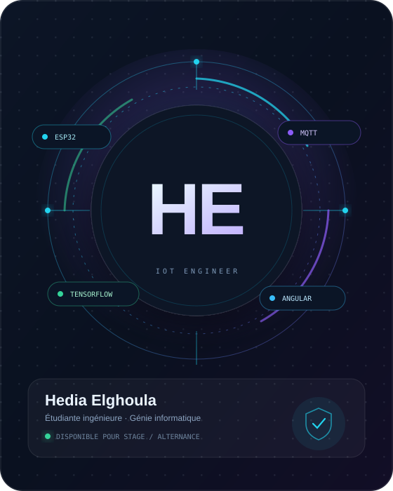

# Portfolio — Hedia Elghoula

Portfolio statique professionnel pour une étudiante ingénieure en génie informatique spécialisée en IoT, systèmes embarqués, IA et développement web/mobile.

## Aperçu

- **Design** sombre par défaut avec thème clair commutable (mémorisé dans le navigateur).
- **100 % statique** : HTML, CSS et JavaScript natifs, aucune dépendance de build.
- **7 visuels de projets** dessinés sur mesure en SVG (aucune image externe, chargement instantané).
- **Interactions** : filtres de projets, fiches projet en modale, animations au scroll, compteurs, formulaire de contact par email.
- **Responsive** du mobile au grand écran, navigation mobile plein écran.
- **Accessibilité** : lien d'évitement, navigation clavier, focus piégé dans la modale, `aria-*`, respect de `prefers-reduced-motion`.
- **SEO** : meta Open Graph, image de partage 1200 × 630, données structurées Schema.org, favicon.

## Lancer le site

Le plus simple : ouvrir `index.html` dans un navigateur.

Pour un rendu fidèle (polices, chemins), servez le dossier avec un petit serveur local :

```bash
cd portfolio
python -m http.server 8000
```

Puis ouvrir <http://localhost:8000>.

## Structure

```
portfolio/
├── index.html                  # Page unique (toutes les sections)
├── assets/
│   ├── css/style.css           # Design system + responsive
│   ├── js/main.js              # Thème, filtres, modale, formulaire…
│   ├── cv/Hedia-Elghoula-CV.pdf
│   └── img/
│       ├── portrait.svg        # Visuel du hero (à remplacer par une photo)
│       ├── og-image.png        # Image de partage (réseaux sociaux)
│       ├── favicon.svg
│       ├── project-sentinelle.svg
│       ├── project-glowix.svg
│       ├── project-robot.svg
│       ├── project-fraude.svg
│       ├── project-maklada.svg
│       ├── project-autocare.svg
│       └── project-benchmark.svg
└── README.md
```

## Personnalisation

### 1. Photo de profil

Le hero utilise actuellement un visuel graphique `assets/img/portrait.svg`. Pour mettre une vraie photo :

1. Ajoutez votre photo dans `assets/img/` (idéalement portrait, ratio 4:5, 800 × 1000 px, JPG/WebP optimisé).
2. Dans `index.html`, remplacez :

```html

```

par :

```html

```

### 2. Images des projets

Chaque carte possède un visuel SVG dans `assets/img/`. Les visuels actuels sont des **illustrations** créées pour le portfolio. Remplacez-les par de vraies captures d'écran ou photos de montage en conservant le même nom de fichier, ou en modifiant les `src` dans `index.html`.

Format conseillé : **1200 × 720 px** (ratio 5:3), JPG/WebP < 300 Ko. Pensez à mettre à jour les attributs `alt`.

Le visuel de recherche (`project-benchmark.svg`) est au format **1200 × 600**.

### 3. Textes et liens

- **LinkedIn** : l'URL `https://www.linkedin.com/in/hedia-elghoula/` est présente dans la section Contact, le footer et le JSON-LD. Mettez-la à jour si nécessaire.
- **CV** : remplacez `assets/cv/Hedia-Elghoula-CV.pdf` par la dernière version (même nom de fichier).
- **Email / téléphone** : à modifier dans la section Contact et le footer.
- **Contenu des projets** : les fiches détaillées (points clés, stack, rôle) se trouvent dans l'objet `projects` de `assets/js/main.js`.
- **Partage social** : une fois le site en ligne, remplacez les chemins relatifs `assets/img/og-image.png` par une URL absolue (`https://votre-domaine.com/assets/img/og-image.png`) dans les balises `og:image` et `twitter:image`, car la plupart des réseaux sociaux n'acceptent pas les chemins relatifs.

### 4. Couleurs

Tout est piloté par des variables CSS en haut de `assets/css/style.css` :

```css
:root {
  --accent: #22d3ee;      /* cyan */
  --accent-2: #8b5cf6;    /* violet */
  --accent-3: #34d399;    /* vert */
  --gradient: linear-gradient(112deg, #67e8f9, #22d3ee, #8b5cf6, #c4b5fd);
}
```

Le thème clair se personnalise dans le bloc `html[data-theme="light"]`.

## Formulaire de contact

Le formulaire fonctionne **sans backend** : il valide les champs puis ouvre la messagerie du visiteur avec un email pré-rempli (`mailto:`). Pour recevoir les messages directement sur le site, branchez un service comme Formspree, Netlify Forms ou un endpoint serverless, puis adaptez le gestionnaire `submit` dans `main.js`.

## Déploiement

Le site est purement statique ; n'importe quel hébergeur convient.

### GitHub Pages

```bash
git init
git add .
git commit -m "Portfolio Hedia Elghoula"
git branch -M main
git remote add origin https://github.com/<votre-compte>/<repo>.git
git push -u origin main
```

Puis dans **Settings → Pages**, choisir la branche `main` et le dossier `/ (root)`. Si le portfolio est dans un sous-dossier, publiez uniquement le contenu de `portfolio/` ou utilisez un workflow GitHub Actions.

### Netlify / Vercel

- **Netlify** : glisser-déposer le dossier `portfolio` dans l'interface, ou connecter le dépôt avec un build vide et `portfolio` comme répertoire de publication.
- **Vercel** : importer le dépôt, framework « Other », aucune commande de build, output directory `portfolio`.

## Notes techniques

- Les polices (Space Grotesk, Inter, JetBrains Mono) sont chargées via Google Fonts avec des polices système de secours.
- Aucun tracking, aucun cookie, aucune dépendance JavaScript externe.
- Les animations sont désactivées automatiquement si l'utilisateur a activé « réduire les animations ».
- Les visuels SVG sont légers et s'adaptent à toutes les résolutions.

## Crédits

Contenu et direction artistique : Hedia Elghoula.  
Visuels de projets : illustrations SVG originales réalisées pour ce portfolio.  
Photo de profil : visuel graphique provisoire (à remplacer par une photographie).
"# Portflio1" 
